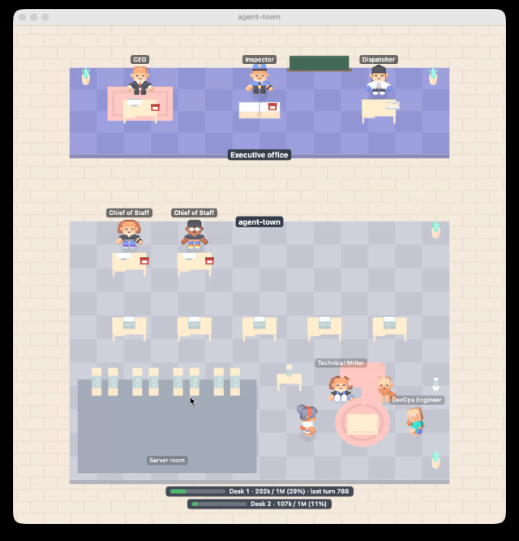

# Agent-Town for Claude Code

Watch your Claude Code agents at work: a Claude Code plugin and a macOS menu bar app (now on Windows too) that show your sessions, subagents, background tasks and approvals as a small 3D office. (Not related to other projects named agent-town.)

Website: [samsonchen.github.io/agent-town-claude-code](https://samsonchen.github.io/agent-town-claude-code/)

[繁體中文說明](README.zh-TW.md)

agent-town shows Claude Code's work as a small office on macOS and Windows, seen from above, with 3D characters. The top-down view was inspired by Gather Town. You are the CEO. Each Claude Code session is a Chief of Staff with a staff of its own, and you can watch them take your tickets, call staff, run background jobs, wait for your approval and phone the report back.

## 1. What agent-town is

### Why it exists

Some tasks in Claude Code take a long time. You type a prompt, Claude Code starts reading files, running commands and calling subagents, and then you wait. I wanted to know two things:

- What is Claude Code doing right now?
- Is it done yet?

The first idea was small: play a sound when a long task finishes. That covers "is it done yet".

While working on the sound, I noticed that Claude Code already says a lot about what it is doing: which tool it is calling, which subagent it started, which background task is running, when it is waiting for approval, when it compacts its notes. A sound uses only the last of these. If every one of those events can be heard, it can also be seen, so the sound grew into an office.

### What it is made of

- **town-link**: a Claude Code plugin that watches what Claude Code does and sends short event messages to the app on your own computer, over a local connection. It never changes what Claude Code does.
- **The agent-town app**: on macOS, a menu bar app that draws the office with RealityKit and plays the sounds; on Windows, a tray app built with Godot that draws the same office.

Nothing leaves your computer except a few short requests per task: town-link asks Haiku, on your own Claude plan or API key, for a task title, the kind of task, and staff roles. See [What town-link reads and sends](docs/privacy.md).

### What it is not

- It is not a dashboard for measuring productivity. It shows what is happening, not how well.
- It does not control Claude Code. You still work in the terminal or the Claude desktop app; agent-town only watches.
- It is not finished. See [Known issues](docs/known-issues.md) and the [roadmap](docs/roadmap.md).



## 2. Installing

You need both parts: the plugin in Claude Code, and the app on your Mac or Windows PC.

### The town-link plugin

town-link is built as a Claude Code mod (a plugin with a hooks module), so it needs a Claude Code version that runs mods: v2.1.287 or later. In a Claude Code session:

```
/plugin marketplace add samsonchen/agent-town-claude-code
```

```
/plugin install town-link@agent-town-claude-code
```

Or from a terminal:

```bash
claude plugin marketplace add samsonchen/agent-town-claude-code
```

```bash
claude plugin install town-link@agent-town-claude-code
```

Then restart Claude Code. In a session, `/town` shows the installed town-link version and whether the plugin is connected to the app, and `/town on` or `/town off` turns sending on or off for all sessions.

Updates are not automatic for this marketplace. To update:

```bash
claude plugin marketplace update agent-town-claude-code
```

```bash
claude plugin update town-link@agent-town-claude-code
```

**In the Claude Desktop app:** the Code tab, the terminal and the VS Code extension on one Mac share plugins installed for your user, so installing once in any of them is enough. To install from the Code tab itself, click **+** next to the prompt box, then **Add plugins**, add the marketplace `samsonchen/agent-town-claude-code`, and install town-link. This only makes sense for Code tab sessions that run on your Mac (see [where it works](docs/known-issues.md#where-it-works-claude-desktop-cowork-and-others)).

Like every plugin with a hooks module, town-link runs with your user's permissions. It only watches: [what it reads and sends](docs/privacy.md).

### The app on macOS

Requires macOS 15 or later. With [Homebrew](https://brew.sh):

```bash
brew tap samsonchen/agent-town-claude-code https://github.com/samsonchen/agent-town-claude-code
```

```bash
brew install --cask samsonchen/agent-town-claude-code/agent-town
```

Or download `AgentTown-<version>.dmg` from [Releases](https://github.com/samsonchen/agent-town-claude-code/releases), open it, and drag AgentTown into Applications.

The app is signed with a Developer ID and notarized by Apple, so it opens like any other app.

The app appears in the menu bar as a small building, with no Dock icon. Open it before you start work: town-link sends events only while the app is running. To have it start with your Mac, turn on Settings → Open at login.

To update: `brew upgrade --cask agent-town`, or download the new `.dmg`.

The plugin and the app have their own version numbers and are updated separately. `/town` shows the plugin's version, and About shows the app's. The numbers don't need to match: what matters is the protocol between them, which both versions check. If they ever can't work together, `/town` says so.

The app checks GitHub once a day for a newer app and a newer town-link (Settings → Updates; it sends nothing about you). When one is out, a dot appears on the menu bar icon, the menu says which, and the Updates window shows the commands for how you installed it. A Claude Code session keeps the town-link it started with, so restart your sessions after updating the plugin.

### The app on Windows

Requires Windows 11 (x64). Windows 10 is allowed by the installer, but the app has not been tested on it. Download `agent-town-setup-<version>.exe` from the newest **agent-town for Windows** release on [Releases](https://github.com/samsonchen/agent-town-claude-code/releases) (tags `windows-v<version>`) and run it. It installs for your user only, with no administrator prompt, and adds agent-town to the Start menu.

The installer is not code-signed yet, so Windows shows "Windows protected your PC" the first time: click **More info**, then **Run anyway**. See the [code signing policy](https://samsonchen.github.io/agent-town-claude-code/code-signing-policy.html).

The app lives in the tray (the notification area), with no taskbar button; closing the office window hides it. Windows 11 first puts a new tray icon among the hidden icons (the **^** arrow); drag it out to keep it in view. To have it start when you sign in, turn on Settings → Open at login.

To update, run the newer installer: it replaces the installed app and keeps your settings. Settings → Updates checks for a newer Windows release once a day, as on the Mac. To remove it: Settings → Apps → Installed apps → agent-town → Uninstall.

Claude Code must run natively on Windows (the terminal, the Desktop app's Code tab, or VS Code). Sessions inside WSL can't reach the app.

## 3. The office

The window shows one office building, seen from above. At the top is the executive office, where you, the CEO, sit beside the Inspector and the Dispatcher. Under it, each project you have open in Claude Code gets a block: its Chief of Staff (the session) takes your tickets, pages staff from the bench for each subagent, sends operators to the server room for background tasks, waits for your approval when Claude Code asks, and phones the report back. You hear a sound when work is dispatched, when it is done, and when your approval is needed.

For a laptop screen, Settings has Compact view (the office at half size) and Hide idle project blocks, and the window can be made small: the view then scrolls by itself to where people are walking.

The whole tour, with the settings: [The office](docs/office.md).

## 4. More

- [Known issues and where it works](docs/known-issues.md): what may not show, and which Claude surfaces work (terminal, the Desktop app's Code tab, VS Code; not cloud sessions or Cowork)
- [What town-link reads and sends](docs/privacy.md): events to the app on your own computer, and a few short Haiku requests per task on your own plan; nothing else
- [Developing agent-town](docs/development.md): running it from source, the checks, trying a change, and releasing
- [All documents](docs/README.md): the spec, the architecture, the protocol, the roadmap

If something in the office looks wrong, or you would like a scene that isn't there yet, please open an issue on GitHub.

## License

Apache 2.0. See [LICENSE](LICENSE). The 3D models are Kenney assets under CC0. See [assets/LICENSES.md](assets/LICENSES.md).
