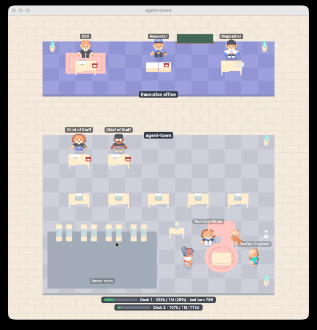

# agent-town：看 Claude Code 的 agent 怎麼工作

[English](README.md)

agent-town 在 macOS 上把 Claude Code 的工作畫成一間小辦公室，從上往下看，裡面是 3D 角色。俯視的畫面受到 Gather Town 的啟發。你是執行長。每個 Claude Code session 是一位幕僚長，各自帶著自己的職員。你可以看著他們接你的工單、找職員來做事、在背景跑工作、等你核准，最後打電話回報。

## 1. agent-town 是什麼

### 為什麼做這個

在 Claude Code 裡，有些工作要做很久。你輸入 prompt，Claude Code 開始讀檔案、跑指令、叫出 subagent，然後你就等。我想知道兩件事：

- Claude Code 現在在做什麼？
- 做完了沒？

一開始的想法很小：長時間的工作做完時，放一個聲音。這解決了「做完了沒」。

做聲音的時候，我發現 Claude Code 其實一直在說它在做什麼：呼叫哪個工具、開了哪個 subagent、哪個背景工作在跑、什麼時候在等核准、什麼時候在整理筆記。聲音只用到最後一件事。既然每件事都能被聽到，也就能被看到，所以聲音後來變成了一間辦公室。

### 由什麼組成

- **town-link**：一個 Claude Code plugin。它觀察 Claude Code 在做什麼，透過本機連線把簡短的事件訊息傳給你 Mac 上的 app。它不會改變 Claude Code 的任何行為。
- **agent-town app**：一個 macOS 選單列 app，用 RealityKit 畫出辦公室，並播放聲音。

除了每個工作一次的簡短請求，沒有任何資料離開你的 Mac：town-link 用你自己的 Claude 方案或 API key 請 Haiku 為工作取一個標題、為職員選一個職稱。工單上顯示的是你輸入的 prompt 原文。

### 它不是什麼

- 它不是衡量生產力的儀表板。它顯示正在發生什麼，不評斷做得好不好。
- 它不控制 Claude Code。你一樣在終端機或 Claude 桌面 app 裡工作，agent-town 只負責看。
- 它還沒做完。請看[已知問題與限制](#4-已知問題與限制)和 [roadmap](docs/roadmap.md)。如果辦公室裡有什麼看起來不對，或你想要一個還沒有的場景，歡迎在 GitHub 開 issue。



## 2. 安裝

兩個部分都要裝：Claude Code 裡的 plugin，和 Mac 上的 app。

### town-link plugin

需要 Claude Code v2.1.287 以上。在 Claude Code session 裡輸入：

```
/plugin marketplace add samsonchen/agent-town
/plugin install town-link@agent-town
```

或在終端機執行：

```bash
claude plugin marketplace add samsonchen/agent-town
claude plugin install town-link@agent-town
```

裝完後重新啟動 Claude Code。在 session 裡，`/town` 會顯示 plugin 有沒有連上 app，`/town on` 或 `/town off` 可以替所有 session 開啟或關閉傳送。

這個 marketplace 不會自動更新。更新方式：

```bash
claude plugin marketplace update agent-town
claude plugin update town-link@agent-town
```

**在 Claude 桌面 app 裡**：同一台 Mac 上的 Code 分頁、終端機和 VS Code 擴充功能共用你這個使用者安裝的 plugin，所以在任一處裝一次就夠了。要從 Code 分頁安裝，按 prompt 輸入框旁的 **+**，選 **Add plugins**，加入 marketplace `samsonchen/agent-town`，再安裝 town-link。這只對在你 Mac 上執行的 Code 分頁 session 有用（見英文 README 的 [Claude Desktop and Cowork](README.md#5-claude-desktop-and-cowork)）。

和所有帶 hooks 模組的 plugin 一樣，town-link 以你的使用者權限執行。安裝前想看它處理哪些事件、呼叫哪些功能，可以在這個 repo 的 clone 裡執行 `claude plugin validate plugin`。

### App

需要 macOS 15 以上。用 [Homebrew](https://brew.sh)：

```bash
brew tap samsonchen/agent-town https://github.com/samsonchen/agent-town
brew install --cask samsonchen/agent-town/agent-town
```

或從 [Releases](https://github.com/samsonchen/agent-town/releases) 下載 `AgentTown-<版本>.dmg`，打開後把 AgentTown 拖進「應用程式」。

App 有 Developer ID 簽章並經過 Apple 公證，可以像一般 app 一樣直接打開。（0.2.7 以前的版本沒有簽章，第一次打開要到「系統設定」→「隱私權與安全性」按 **強制打開**。）

App 會以一棟小建築的圖示出現在選單列，Dock 裡沒有圖示。開始工作前先打開它：town-link 只在 app 執行時傳送事件。要讓它開機時自動啟動，打開「設定」→「登入時開啟」。

更新：`brew upgrade --cask agent-town`，或下載新的 `.dmg`。

## 3. 辦公室

視窗裡是一棟從上往下看的辦公大樓。最上面是執行長辦公室，下面是你在 Claude Code 裡開著的每個專案各一個辦公區塊。

### 執行長辦公室

最上方的一長條，三個人各坐在自己的桌前：

- **執行長**就是你。你輸入的每個 prompt 會變成一張工單，執行長打電話把它交給那個 session 的幕僚長。回報也用電話傳回給執行長。Claude Code 在等你核准時，執行長的電話會一直響到你回應為止。你可以用方向鍵移動執行長（按 H 回到座位）；點一個角色，執行長會走過去，那個角色會說它的工作進行得如何。
- **調度員**負責排程工作，例如 `/loop` 和其他排程 prompt。每個進行中的排程是調度員桌旁看板上的一張卡片，顏色和它所屬專案的區塊相同。排程觸發時，調度員用無線電把工單交給幕僚長，回報則傳回給調度員。
- **稽核員**站在接待處。當某個 hook（例如檢查測試是否通過）不讓 Claude Code 結束、把它退回去繼續工作時，幕僚長的回報會先到稽核員，而不是執行長。稽核員會顯示 hook 給的理由，幕僚長頭上出現「退回」章，工作繼續進行。

### 專案區塊

- **一個專案一個區塊。** 在某個專案開啟 Claude Code session 時，還沒輸入任何 prompt，區塊就會出現；那個專案的最後一個 session 結束時，區塊就離開。區塊在執行長辦公室下方往下排，視窗會跟著變長。
- **招牌**顯示專案名稱，和正在進行的工作的簡短標題。區塊下方的長條顯示 session 的上下文用量。
- **桌子**：一張有電話的幕僚長桌，和五張職員桌。同一個專案開第二個 session，會多一位幕僚長。
- **休息區**是職員在兩份工作之間等待的地方。幕僚長透過休息區的喇叭廣播找人。
- **機房**有機櫃，作業員在這裡執行背景工作。

### 區塊裡的人

- **幕僚長**代表一個 Claude Code session。幕僚長接下工單，依工作類型戴上帽子，再分派工作。做完後，打電話把回報交給發出工單的人。
- **職員**負責做事。主 agent 自己的工作，幕僚長會找職稱符合正在修改的檔案的職員來做（改 `.ts` 檔就找 TypeScript 工程師，依此類推）；每個 subagent 也是一位職員。他們從休息區過來，在桌前工作，做完就回報。
- **作業員**穿安全橘色，在機房執行背景工作，再把結果帶回給幕僚長。
- **整理筆記**：Claude Code 壓縮對話時，幕僚長會在桌上整理一疊筆記。

### 聲音和設定

- 工單送達、工作完成、Claude Code 需要你核准時，都會有聲音，視窗隱藏時也一樣。
- 選單列選單有「關於 agent-town」、「顯示 agent-town」、「保持在最上層」、「聲音」、「顯示提示」、「設定…」和「結束 agent-town」。「保持在最上層」會讓辦公室視窗留在其他 app 的視窗上方，即使你正在使用別的 app 也一樣。你的選擇在重新啟動後會保留，視窗也會在上次的位置打開。
- 「設定」裡有語言（英文或繁體中文，預設跟隨 macOS）和「登入時開啟」。

## 4. 已知問題與限制

- **由組織管理 Claude Code 時，有些場景可能不會出現。** 用 Team 或 Enterprise 帳號登入時，Claude Code 會略過你自己安裝的 plugin 的部分事件，town-link 也在其中。你可以在 `/plugin` → Errors 看到。用個人帳號時這些場景都正常。
  - 自動壓縮：上下文滿了、Claude Code 自行壓縮對話時，辦公室不會有任何畫面。自己輸入 `/compact` 則一定會顯示。
  - 退回的工作：hook 把 Claude Code 退回去工作時，稽核員的場景可能不會出現。工作本身照常進行。
  - auto mode 的核准聲：auto mode 的分類器回答核准請求時，agent-town 通常不出聲。在組織管理下，它只能從 session 開始時的設定得知你的權限模式，所以如果你用 Shift+Tab 切到 auto mode，比較慢的核准請求仍可能播放核准聲。
- **App 關著時做的工作，事後不會補顯示。** town-link 只在 app 執行時傳送事件，其他時候直接丟掉。已經在跑的 Claude Code session 會在 app 啟動後幾秒內出現，從那時開始顯示。
- **用 `!` 執行的指令不會出現在辦公室裡。** Claude Code 直接在你的 shell 執行這些指令，不經過模型，也不通知 plugin。如果之後 Claude 接著工作，那部分會照常顯示，幕僚長的便條寫著「繼續工作」。
- **Session 停止後約兩分鐘才離開辦公室。** Claude Code session 結束或沒有回應時，它的幕僚長會留到 app 兩分鐘沒收到任何訊息為止。
- **視窗太小時，標籤可能蓋住靠上方的角色。** 名牌和便條會往下移以留在視窗內，所以在矮的視窗裡可能壓在角色頭上。把視窗拉高或捲動即可。
- **工作標題和職稱會用到你的 Claude 方案。** 每個新工作會用你自己的方案或 API key 向 Haiku 發一個簡短請求，選標題和職稱。請求失敗時，招牌不顯示工作標題，帽子和職稱改用預設值。
- **只支援 macOS。** App 需要 macOS 15 以上。

Claude Desktop 與 Cowork 的支援情況、文件和開發說明，請看[英文 README](README.md)。
