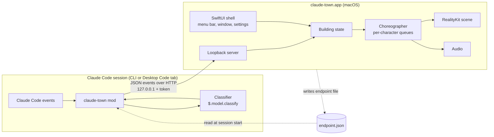

# Architecture

## Components



Responsibilities are split this way:

| Mod (one per Claude Code session) | App (one per machine) |
|---|---|
| Listens to Claude Code events | Owns all visuals, sounds, and translations |
| Decides roles and task types with `$.model.classify`, and sends IDs | Maps role and task-type IDs to character looks and labels |
| Sends small JSON events; never blocks Claude | Turns events into scenes; applies timing and sound rules |
| Knows nothing about drawing | Knows nothing about Claude Code internals beyond the protocol |

The protocol between them is in [protocol.md](protocol.md). It has no macOS-specific parts, so a Windows or Linux app can implement the same protocol later.

## Repository layout

```
claude-town/
├── .claude-plugin/
│   └── marketplace.json        # makes this repo a plugin marketplace
├── plugin/                     # the Claude Code plugin containing the mod
│   ├── .claude-plugin/plugin.json
│   └── hooks/
│       ├── hooks.json          # "modules": ["./register.ts"]
│       ├── register.ts
│       └── *.test.ts
├── catalog/
│   ├── roles.json              # role IDs + labels per locale (source of truth)
│   ├── task-types.json         # task type IDs + hat labels per locale
│   ├── models.json             # model ID patterns → badge family names
│   └── characters.json         # base characters, shirt swatch, department colors
├── protocol/
│   ├── schema/                 # JSON Schema for every event
│   └── fixtures/               # recorded event streams for tests and demos
├── app/macos/                  # Xcode project
├── assets/
│   ├── kenney/                 # source GLB models + each pack's License.txt
│   ├── models/                 # USDZ files generated by tools/convert-assets.py (committed)
│   └── LICENSES.md             # every asset, its source, and its license
├── tools/
│   └── convert-assets.py       # Blender script: GLB → USDZ, with animation clip ranges
└── docs/
```

`catalog/` is used by both sides. The mod needs the role and task-type IDs to classify. The app needs the labels and the look of each role (department color, prop). Only the app reads `models.json`.

### Model families (`catalog/models.json`)

The mod sends model IDs as Claude Code reports them. The app turns an ID into a badge using an ordered list of entries in `catalog/models.json`. Each entry has a `match` substring and a `family` label, such as `{"match": "opus", "family": "Opus"}`. The first entry whose `match` appears in the ID (compared in lowercase) wins. Matching on a substring, not a prefix, covers provider forms such as `us.anthropic.claude-opus-...`. A new model family needs only a new entry, with no code change.

An ID that matches no entry is shown in short form:

1. Drop any provider prefix up to and including `anthropic.`.
2. Drop a leading `claude-`.
3. Drop a bracketed suffix such as `[1m]`.
4. Drop a trailing date such as `-20251001`.
5. Cut to 12 characters.

Family names are product names and are not translated.

## Event mapping (mod side)

| Claude Code event | Mod action | Protocol event |
|---|---|---|
| `session.start` | Read the endpoint file, register `/town`, start the outbox and heartbeat timers, work out the project | `session.open` |
| `session.end` | Flush the outbox | `session.close` |
| `prompt.submit` | Start task-type classification in the background; pass the prompt on unchanged | `ticket.submit`, later `chief.hat` |
| `turn.complete` without `agentId` | Read `durationMs`, `isAborted` | `ticket.done` |
| `agent.spawn` | Pass on unchanged; read `agentId` from the result; start role classification in the background | `staff.hire`, later `staff.role` |
| `turn.complete` with `agentId` | | `staff.done` |
| `tool.call` | Map the tool to an activity; send it before the tool runs | `activity` |
| `tool.check` returning `ask` | | `approval.wait` |
| `tool.call` result after an `ask` | | `approval.end` |
| `turn.step` | `yield* next(e)` and return its result unchanged; skip steps from claude-town's own classification calls (see "Model badge source"); read `result.usage.model`; compare with the last model sent for that `agentId` (or the main agent) | `model.update` when it changed |
| `tool.call` for a background task (`Bash` with `run_in_background`, `Monitor`, `Workflow`) | Pass on unchanged; read the task ID from the result; decide the role by rule or start classification in the background | `task.start`, later `task.role` |
| Background task ends (see "Turn origin") | | `task.done` |
| `tool.call` for a schedule tool (`CronCreate`, `ScheduleWakeup`) | Pass on unchanged; read the schedule ID from the result | `schedule.create` |
| `tool.call` for `CronDelete`, or `ScheduleWakeup` with `stop` | | `schedule.delete` |
| Main-agent turn starts with no open ticket | Work out the origin (see "Turn origin") | `ticket.submit` with `origin` |
| A Stop hook blocks the end of the main turn | Keep the ticket open | `ticket.return` |
| `tool.call` for `SendMessage` (or the agent-team message tool) | Pass on unchanged; resolve the receiver's name to an `agentId` from the names seen in `agent.spawn` | `message.send` |
| `$.clock.every` timer | | `heartbeat` |

Rules for every hook:

- Pass every event on unchanged. The mod only observes.
  - Ordinary hooks return `next(e)`, or the result of `await next(e)`.
  - Generator hooks such as `turn.step` use `const result = yield* next(e)` and then `return result`. They never yield values of their own. (Phase 0 item 11 confirms that `turn.step` is a generator hook.)
- Never `await` a network call or a classification inside a hook. Push the event into an outbox and return.
- An outbox timer (`$.clock.every`, about every 250 ms) sends queued events in one POST. If the app is not running, drop the batch and try the endpoint file again later. Do not retry old events.
- Wrap everything in `try`/`catch`. A failure in claude-town must never affect the Claude Code session.

### Model badge source

- **Chief of Staff:** `session.open` carries `$.session.model()`. After that, `turn.step` events with no `agentId` update it.
- **Staff:** `staff.hire` carries the requested model when one was set. After that, `turn.step` events with that `agentId` update it.
- **claude-town's own calls:** the Haiku calls made by `$.model.classify` must not change any badge. If those calls also go through `turn.step`, the mod has to recognize and skip them (Phase 0 item 12). If they cannot be told apart, the mod reads the Chief of Staff's model only from `$.session.model()`, checked on `prompt.submit` and `turn.complete`, and uses `turn.step` for staff only.

### Turn origin

A main-agent turn that does not start from `prompt.submit` still gets a ticket. The mod works out who issued it:

1. **Task:** the turn's input is a background task notification. Read the task IDs and statuses from it, send `task.done` for each one, then send `ticket.submit` with `origin: task`, `taskIds`, and `parentTicketId` (the ticket that was open when the first of those tasks started).
2. **Schedule:** the turn's input is a scheduled prompt, or a schedule from this session was due within the last few seconds. Send `ticket.submit` with `origin: schedule`.
3. **Otherwise:** `origin: unknown`.

How the mod sees the start of such a turn and its input is Phase 0 item 13. If a task ends and no new turn follows, `task.done` is still sent as soon as the mod learns of it (Phase 0 item 14).

A Stop-hook continuation is not a new ticket. If the mod sees the main turn end and then continue on the same ticket, it sends `ticket.return` and does not send `ticket.done` until the turn really ends (Phase 0 item 15).

### Background roles by rule

Most background tasks can be given a role without a model call:

| Task | Role |
|---|---|
| `Monitor` | `log-monitor` |
| `Workflow` | `workflow-coordinator` |
| Shell command matching build words (`build`, `make`, `compile`, `docker build`, `cargo build`, `xcodebuild`) | `build-operator` |
| Shell command matching test words (`test`, `pytest`, `jest`, `vitest`, `go test`) | `test-runner` |
| Shell command matching server words (`dev`, `serve`, `start`, `watch`, `run server`) | `server-operator` |
| Shell command matching install words (`npm install`, `pnpm add`, `pip install`, `brew install`, `download`, `curl -O`) | `install-operator` |
| Shell command matching deploy words (`deploy`, `release`, `publish`) | `deploy-operator` |
| Anything else | Classify with the background role IDs as labels; fallback `background-worker` |

The word lists live in `catalog/roles.json` with each background role, so they can change without changing code.

### Project identity

The floor is keyed by the project:

1. `$.session.repo()`, when it returns a repository: use its remote identity.
2. Otherwise `$.session.root()`: use the absolute path.

`projectId` is a hash of that value. The display name is the repository name or the folder name. The full path is not sent.

### Classification

Both use `$.model.classify(text, labels, options)`.

- **Role** (on `agent.spawn`): text is `subagentType`, `name`, `description`, and the first part of `prompt`. Labels are the role IDs from `catalog/roles.json`. If `subagentType` is exactly a role ID (a custom agent named after a role), use it without a model call. If classification fails or returns nothing, use `generalist`. Cache by `agentId`.
- **Task type** (on `prompt.submit`): text is the first part of the prompt. Labels are the IDs from `catalog/task-types.json`. Fallback `general`.

These calls use the user's plan or API key. The README must say so. If the role list is too long for one call, split it into two steps: department first, then role within the department.

### The `/town` command

| Command | Effect |
|---|---|
| `/town` | Show status: connected or not, enabled or not |
| `/town on`, `/town off` | Enable or disable sending, saved in `$.store` (shared by all sessions on the machine) |

Registered with `immediate: true` so it works while Claude is busy.

## App side

| Module | Technology | Job |
|---|---|---|
| Shell | SwiftUI, `MenuBarExtra` | Main window, menu bar toggle, settings, first-run screen |
| Loopback server | Network.framework (`NWListener`) | Binds 127.0.0.1 on a random port; checks the token and protocol version; writes the endpoint file |
| Building state | Swift model | Floors, sessions, characters, pending approvals. Pure logic, unit-tested with fixtures. |
| Choreographer | Swift | Turns state changes into per-character action queues; applies the timing rules |
| Scene | RealityKit in a SwiftUI `RealityView`, orthographic camera at a fixed isometric angle | Draws floors, elevator, furniture, characters, tickets, hats; plays character animation clips; handles scrolling |
| Labels | SwiftUI overlay | Name tags, hats, model badges, ticket text. Drawn in 2D over the 3D view at each character's projected position, so text stays sharp and uses the Cubic 11 font. |
| Audio | AVFoundation | Completion and approval sounds; applies the duration gate |
| Localization | String Catalogs plus `catalog/*.json` | UI strings and role/task labels in English and Traditional Chinese |

### Assets pipeline

- Source models are Kenney GLB files in `assets/kenney/`.
- `tools/convert-assets.py` runs in Blender without its window (`blender -b --python tools/convert-assets.py`). Blender's USD export writes only one animation per file, so the script lays the animation clips we use end to end on one timeline. It exports one USDZ per character and writes `assets/models/clips.json` with each clip's start and end time.
- The app loads each character's single animation and cuts it into clips using the times in `clips.json`.
- Generated USDZ files are committed, so building the app does not need Blender. Run the script again only when the source models or the clip list change.
- **Outfits:** every Kenney character uses one shared 512×512 color texture made of swatches. Each character gets its own copy of the texture, with its shirt swatch changed to the department color. `catalog/characters.json` records which swatch is the shirt on each base character.

### Building state

```
Building
├── executiveFloor
│   ├── ceo
│   ├── dispatcher
│   │   └── board: schedules[scheduleId] (sessionId, text, recurring, nextRunTs)
│   └── inspector
└── floors[projectId]
    ├── bench[characterId] (outfit, lastRole, waitingSince)
    └── chiefs[sessionId]
        ├── currentTicket (origin, issuer, returnedCount)
        ├── hat (taskType | none)
        ├── staff[agentId] (role, status, activity)
        └── operators[taskId] (role, kind, status, startedTicketId)
```

The bench belongs to the floor, not to a session. Staff and operators are *characters* that move between the bench and a job. A hire or task start takes a character from the bench, and `staff.done` or `task.done` returns it. The protocol knows nothing about the bench. It is purely app-side presentation.

The state is updated from protocol events only. The choreographer reads state changes and schedules animations. Keeping these separate lets the state be tested without RealityKit, and lets a later Windows app reuse the same design.

### Stale sessions

If a session sends no event and no heartbeat for a configurable time (default 2 minutes), treat it as closed (scene 10). This covers crashed or killed sessions that never sent `session.close`.

## Security

- The app listens on 127.0.0.1 only.
- Every request must carry the token from the endpoint file. The endpoint file is readable only by the user (mode 0600).
- The app treats event text as display text only. It never runs commands or opens URLs from events.
- The mod sends only the first 200 characters of a prompt or a subagent description. Whether that text is shown is decided by the app's ticket text setting.
