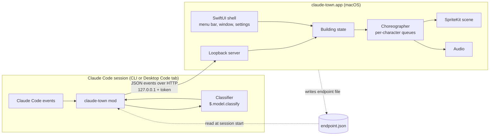

# Architecture

## Components



Responsibilities are split this way:

| Mod (one per Claude Code session) | App (one per machine) |
|---|---|
| Listens to Claude Code events | Owns all visuals, sounds, and translations |
| Decides roles and task types with `$.model.classify`, and sends IDs | Maps role and task-type IDs to sprites and labels |
| Sends small JSON events; never blocks Claude | Turns events into scenes; applies timing and sound rules |
| Knows nothing about drawing | Knows nothing about Claude Code internals beyond the protocol |

The protocol between them is in [protocol.md](protocol.md). It has no macOS-specific parts, so a Windows or Linux app can implement the same protocol later.

## Repository layout

```
claude-town/
├── .claude-plugin/
│   └── marketplace.json        # makes this repo a plugin marketplace
├── plugin/                     # the Claude Code plugin containing the mod
│   ├── .claude-plugin/plugin.json
│   └── hooks/
│       ├── hooks.json          # "modules": ["./register.ts"]
│       ├── register.ts
│       └── *.test.ts
├── catalog/
│   ├── roles.json              # role IDs + labels per locale (source of truth)
│   └── task-types.json         # task type IDs + hat labels per locale
├── protocol/
│   ├── schema/                 # JSON Schema for every event
│   └── fixtures/               # recorded event streams for tests and demos
├── app/macos/                  # Xcode project
├── assets/                     # sprites, sounds, font, with LICENSES.md
└── docs/
```

`catalog/` is used by both sides. The mod needs the role and task-type IDs to classify. The app needs the labels and sprite keys.

## Event mapping (mod side)

| Claude Code event | Mod action | Protocol event |
|---|---|---|
| `session.start` | Read the endpoint file, register `/town`, start the outbox and heartbeat timers, work out the project | `session.open` |
| `session.end` | Flush the outbox | `session.close` |
| `prompt.submit` | Start task-type classification in the background; pass the prompt on unchanged | `ticket.submit`, later `chief.hat` |
| `turn.complete` without `agentId` | Read `durationMs`, `isAborted` | `ticket.done` |
| `agent.spawn` | Pass on unchanged; read `agentId` from the result; start role classification in the background | `staff.hire`, later `staff.role` |
| `turn.complete` with `agentId` | | `staff.done` |
| `tool.call` | Map the tool to an activity; send it before the tool runs | `activity` |
| `tool.check` returning `ask` | | `approval.wait` |
| `tool.call` result after an `ask` | | `approval.end` |
| `$.clock.every` timer | | `heartbeat` |

Rules for every hook:

- Return `next(e)` (or the result of `await next(e)`) unchanged. The mod only observes.
- Never `await` a network call or a classification inside a hook. Push the event into an outbox and return.
- An outbox timer (`$.clock.every`, about every 250 ms) sends queued events in one POST. If the app is not running, drop the batch and try the endpoint file again later. Do not retry old events.
- Wrap everything in `try`/`catch`. A failure in claude-town must never affect the Claude Code session.

### Project identity

The floor is keyed by the project:

1. `$.session.repo()`, when it returns a repository: use its remote identity.
2. Otherwise `$.session.root()`: use the absolute path.

`projectId` is a hash of that value. The display name is the repository name or the folder name. The full path is not sent.

### Classification

Both use `$.model.classify(text, labels, options)`.

- **Role** (on `agent.spawn`): text is `subagentType`, `name`, `description`, and the first part of `prompt`. Labels are the role IDs from `catalog/roles.json`. If `subagentType` is exactly a role ID (a custom agent named after a role), use it without a model call. If classification fails or returns nothing, use `generalist`. Cache by `agentId`.
- **Task type** (on `prompt.submit`): text is the first part of the prompt. Labels are the IDs from `catalog/task-types.json`. Fallback `general`.

These calls use the user's plan or API key. The README must say so. If the role list is too long for one call, split it into two steps: department first, then role within the department.

### The `/town` command

| Command | Effect |
|---|---|
| `/town` | Show status: connected or not, enabled or not |
| `/town on`, `/town off` | Enable or disable sending, saved in `$.store` (shared by all sessions on the machine) |

Registered with `immediate: true` so it works while Claude is busy.

## App side

| Module | Technology | Job |
|---|---|---|
| Shell | SwiftUI, `MenuBarExtra` | Main window, menu bar toggle, settings, first-run screen |
| Loopback server | Network.framework (`NWListener`) | Binds 127.0.0.1 on a random port; checks the token and protocol version; writes the endpoint file |
| Building state | Swift model | Floors, sessions, characters, pending approvals. Pure logic, unit-tested with fixtures. |
| Choreographer | Swift | Turns state changes into per-character action queues; applies the timing rules |
| Scene | SpriteKit, isometric `SKTileMapNode` | Draws floors, elevator, characters, tickets, hats; handles scrolling |
| Audio | AVFoundation | Completion and approval sounds; applies the duration gate |
| Localization | String Catalogs plus `catalog/*.json` | UI strings and role/task labels in English and Traditional Chinese |

### Building state

```
Building
├── executiveFloor (CEO)
└── floors[projectId]
    └── chiefs[sessionId]
        ├── currentTicket
        ├── hat (taskType | none)
        └── staff[agentId] (role, status, activity)
```

The state is updated from protocol events only. The choreographer reads state changes and schedules animations. Keeping these separate lets the state be tested without SpriteKit, and lets a later Windows app reuse the same design.

### Stale sessions

If a session sends no event and no heartbeat for a configurable time (default 2 minutes), treat it as closed (scene 10). This covers crashed or killed sessions that never sent `session.close`.

## Security

- The app listens on 127.0.0.1 only.
- Every request must carry the token from the endpoint file. The endpoint file is readable only by the user (mode 0600).
- The app treats event text as display text only. It never runs commands or opens URLs from events.
- The mod sends only the first 200 characters of a prompt or a subagent description. Whether that text is shown is decided by the app's ticket text setting.
